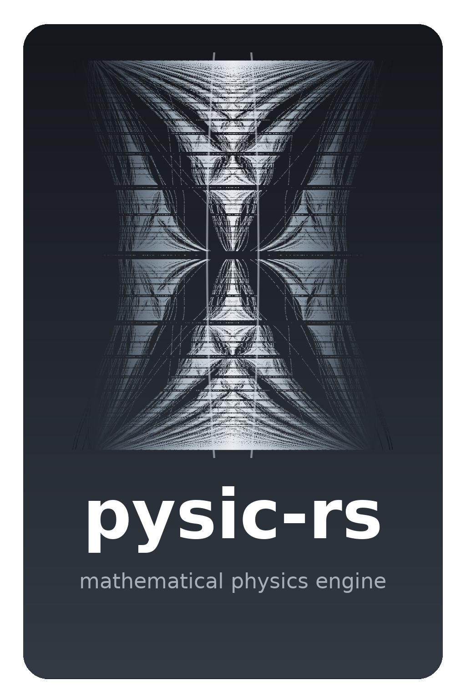

# Pysic-rs

**Mathematical physics engine in Rust with Python bindings — graded against closed forms.**

<p align="center">
  
</p>

<div align="center">

[](https://pysic-rs.readthedocs.io/)
[](https://pypi.org/project/pysic-rs/)
[](https://crates.io/crates/pysic-rs)
[](https://github.com/ThotDjehuty/pysic-rs/blob/main/LICENSE)
[](https://www.python.org/)
[](https://www.rust-lang.org/)

**📖 [Documentation](https://pysic-rs.readthedocs.io/) · 📦 [PyPI](https://pypi.org/project/pysic-rs/) · 🦀 [crates.io](https://crates.io/crates/pysic-rs) · 🐙 [GitHub](https://github.com/ThotDjehuty/pysic-rs) · 📝 [Changelog](CHANGELOG.md)**

</div>

---

## Why Pysic-rs?

- **Graded, not asserted.** Every routine is compared against a quantity known
  *independently* of it — a closed form, a tabulated value, or a conserved
  invariant. Measured accuracy is published per function
  ([table below](#measured-accuracy)), not rounded off.
- **CPU-only, by design.** No GPU backend and none planned. Nothing in the core
  depends on Python, on BLAS or LAPACK, or on a GPU runtime.
- **Lean.** Pure-Rust core with no mandatory dependencies beyond `ndarray` /
  `num-*` / `rustfft`; the `PyO3` layer is optional and feature-gated. Installs
  from source on a bare machine with only a Rust toolchain.
- **Fractal, on purpose.** The logo is
  [Hofstadter's butterfly](https://en.wikipedia.org/wiki/Hofstadter%27s_butterfly) —
  the spectrum of electrons in a magnetic field. pysic-rs computes that very
  spectrum.

> ### A note on validation, and on 0.1.0
>
> Earlier revisions of this README claimed that "every solver is checked against
> closed-form results — graduating from a *should be right* to an *is right*
> guarantee." That claim was false. Building a reproduction notebook for the
> companion paper and running the documented API against SciPy for the first
> time exposed **eight incorrect routines** in 0.1.0: `J0(7.98)` returned
> `+50.6` for a function bounded by 1, `Ai(0)` returned `NaN`, `E_1(1)` returned
> `54.23` where the value is `0.2194`, a vacuum spacetime reported non-zero
> Ricci curvature, an eigensolver returned the matrix diagonal instead of the
> spectrum, and a Dirac propagator's norm grew without bound. The
> special-function suite was not reachable from Python at all.
>
> In every case a test existed or could trivially have existed. The tests that
> *were* written could not have failed: `bessel_j0` was checked only at `x = 0`
> and `x = 1`, never near its broken branch switch, and `zeta(2)` was asserted
> with a tolerance of `1e-3` — loose enough to pass a routine wrong in the
> fourth digit. There was no Airy test and no exponential-integral test.
>
> All eight are repaired in **0.2.0**, each held by a test that fails on the
> previous code. **0.1.0 should not be used.** The discriminating property of a
> useful numerical test is not coverage but falsifiability against an
> independently known quantity — see [CHANGELOG.md](CHANGELOG.md) for the full
> post-mortem.

---

## Measured accuracy

Maximum deviation against SciPy on dense grids, measured by the companion
reproduction notebook (which ships with the paper artifact and regenerates this
table):

| Function | Domain | Measured error | Method |
|---|---|---|---|
| `gamma` | (0, 170] | 2.7e-13 rel. | Lanczos |
| `ln_gamma` | (0, 200] | 1.8e-15 rel. | Lanczos (log form) |
| `beta` | a, b ≥ 0.3 | 7.3e-15 rel. | via ΓΓ |
| `erf`, `erfc` | (0, 6] | 1.4e-7 abs. | A&S 7.1.26 † |
| `bessel_j0`, `bessel_j1` | (−30, 30) | 9.9e-12 abs. | series + Hankel asym. |
| `bessel_y0`, `bessel_y1` | (0, 30] | 3.4e-11 abs. | series + Hankel asym. |
| `legendre_p`, `legendre_plm` | (−1, 1) | 7.2e-15 abs. | recurrence |
| `chebyshev_t`, `chebyshev_u` | (−1, 1) | 2.9e-15 abs. | recurrence |
| `airy_ai` | (−20, 10] | 7.7e-10 abs. | series + asymptotic † |
| `expint_en`, n ≤ 6 | (0, 10] | 1.1e-14 rel. | series + Lentz CF |
| `zeta` | (1, 30] | 1.1e-15 rel. | Euler–Maclaurin |

† Limited by the formula, not the port: A&S 7.1.26 is 1.5e-7 by construction,
and `airy_ai` is machine-precision where its series is used, the quoted figure
coming from the asymptotic branch beyond. `gamma` overflows past x ≈ 171.6, as
the type requires. Relative error for `ln_gamma` is reported where |lnΓ| > 1,
since lnΓ vanishes at x = 1 and x = 2.

Three classes of invariant do most of the grading, because each is falsifiable
without knowing the answer: **unitarity** (a norm that must not change),
**vanishing on a known solution** (Schwarzschild is a vacuum, so R ≡ 0), and
**integrality** (a winding number of 2.9997 is not imprecise, it is broken).

---

## The mathematics

**Schrödinger equation** (`pde` — split-step Fourier, unitary by construction)

$$i\hbar\frac{\partial}{\partial t}\psi(\mathbf{r},t)=\left[-\frac{\hbar^{2}}{2m}\nabla^{2}+V(\mathbf{r})\right]\psi(\mathbf{r},t)$$

**Dirac equation** (`pde` — split-step; the mass factor is an exact rotation)

$$\left(i\gamma^{\mu}\partial_{\mu}-m\right)\psi=0,
\qquad e^{-i\theta\sigma_x/2}=\cos(\theta/2)\,\mathbf{1}-i\sin(\theta/2)\,\sigma_x$$

**Harper equation → Hofstadter butterfly** (`topology` — Chern numbers, Berry phase)

$$\psi_{n+1}+\psi_{n-1}+2\cos(2\pi n\alpha)\,\psi_{n}=E\psi_{n}$$

**Schwarzschild metric** (`general_relativity` — Christoffel, Riemann, geodesics, ADM)

$$ds^{2}=-\left(1-\frac{2GM}{c^{2}r}\right)c^{2}dt^{2}+\left(1-\frac{2GM}{c^{2}r}\right)^{-1}dr^{2}+r^{2}d\Omega^{2}$$

**Gauss linking number** (`topology::chern_simons` — an integer invariant)

$$\mathrm{lk}(\gamma_1,\gamma_2)=\frac{1}{4\pi}\oint_{\gamma_1}\!\oint_{\gamma_2}
\frac{(\mathbf r_1-\mathbf r_2)\cdot(d\mathbf r_1\times d\mathbf r_2)}{|\mathbf r_1-\mathbf r_2|^{3}}\in\mathbb Z$$

**Casimir force** (`casimir` — parallel plates, Lifshitz theory)

$$F=-\frac{\pi^{2}\hbar c}{240\,a^{4}}A$$

> **Note on rendering**: GitHub renders a *subset* of LaTeX. For fully typeset
> math open the [documentation site](https://pysic-rs.readthedocs.io/).

---

## Modules

| Module | Description |
|--------|-------------|
| **special_functions** | Gamma, Bessel (J/Y), Legendre, erf, zeta, Airy, Chebyshev, exponential integrals — all 18 reachable from Python since 0.2.0 |
| **linalg** | Cholesky, LU, inverse, determinant, tensor ops, Lie brackets |
| **calculus** | gradient, Hessian, Simpson/Romberg integration, interpolation |
| **ode** | RK4, RK45 (Dormand–Prince, FSAL with embedded error control), backward Euler, symplectic |
| **pde** | Schrödinger (split-step), Dirac, heat, wave, Poisson, Maxwell FDTD |
| **fourier** | FFT/IFFT, spectral derivatives, Welch PSD |
| **quantum** | Pauli algebra, density matrices, path integrals, Feynman propagators |
| **general_relativity** | Schwarzschild/Kerr/FLRW metrics, Christoffel/Riemann, geodesics, ADM constraints |
| **gauge** | SU(2)/SU(3) structure constants, Yang–Mills, connections, curvature |
| **classical** | Hamiltonian/Lagrangian, rigid body (Euler equations), rotations |
| **topology** | Berry phase, Chern numbers, winding numbers, skyrmion charge, **Chern–Simons**: Gauss linking numbers, `sl(2,R)` holonomy, BTZ mass/spin |
| **em** | Green's functions (static, retarded, Helmholtz), radiation formulas |
| **casimir** | Parallel plates, sphere, Lifshitz theory, Polder potential |

---

## Quick Start

```python
import numpy as np
import pysicrs as ps

# Special functions are elementwise and shape-preserving: a float returns a
# float, any sequence returns a list. Two-argument functions broadcast, and a
# length mismatch raises rather than truncating.
x = np.linspace(0.1, 25, 800)
ps.bessel_j0(x)        # -> list of 800 floats
ps.bessel_j0(2.5)      # -> -0.04838377646...
ps.beta(x, 2.0)        # scalar broadcasts against the sequence

# Closed forms hold exactly where the physics says they must
ps.zeta(2.0)           # pi^2 / 6
ps.zeta(-1.0)          # -1/12, via the functional equation
ps.airy_ai(0.0)        # 3^(-2/3) / Gamma(2/3)

# A vacuum solution has identically zero Ricci scalar
ps.ricci_scalar([0.0, 6.0, np.pi / 2, 0.0], 1e-4)    # ~5e-9 (FD residual)

# Topological invariants are integers
theta = np.linspace(0, 2 * np.pi, 2001)[:-1]
z = np.exp(3j * theta)
ps.winding_number(z.real.tolist(), z.imag.tolist())  # exactly 3.0

# The BTZ black hole as a flat SL(2,R) x SL(2,R) Chern-Simons connection
ps.btz_mass_spin(r_plus=2.1, r_minus=0.8, ell=1.3)   # (M, J)
```

---

## Installation

**From PyPI** (Python 3.8+, prebuilt `abi3` wheels):

```bash
pip install pysic-rs
```

**From crates.io** (Rust):

```bash
cargo add pysic-rs
```

**From source** — needs only a Rust toolchain ([rustup](https://rustup.rs)); no
BLAS, LAPACK or GPU runtime:

```bash
git clone https://github.com/ThotDjehuty/pysic-rs.git
cd pysic-rs
pip install maturin
maturin develop --release
```

---

## Development

```bash
cargo test                      # Rust test suite (62 tests)
python -m pytest tests/         # Python binding tests
cd docs && make html            # Sphinx / Furo docs
maturin build --release         # build the abi3 wheel
```

### Reproducing the published results

The companion paper's reproduction artifact builds an environment, registers a
Jupyter kernel and executes a notebook that regenerates the accuracy table
above, re-checks all eight repaired defects against closed forms, and
reconciles every number against the paper.

---

## License

MIT — see [LICENSE](LICENSE).

## Author

HFThot Research Lab — <contact@hfthot-lab.eu>

---

*CPU-only mathematical physics, graded against closed forms — powered by Rust, bound to Python.*
